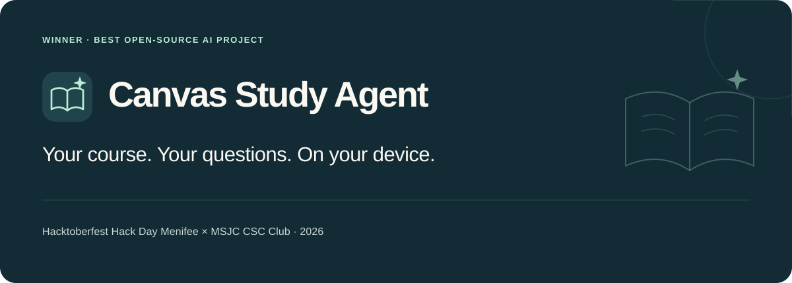
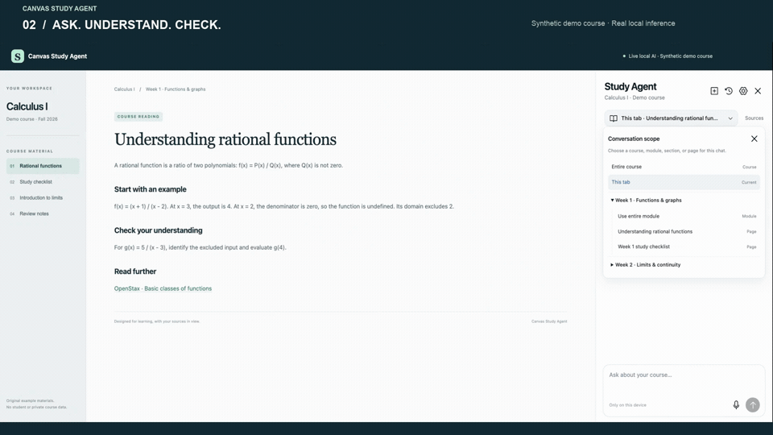
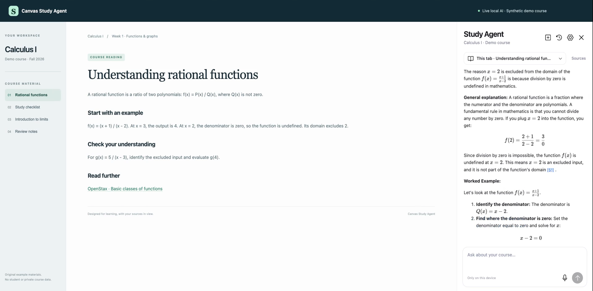
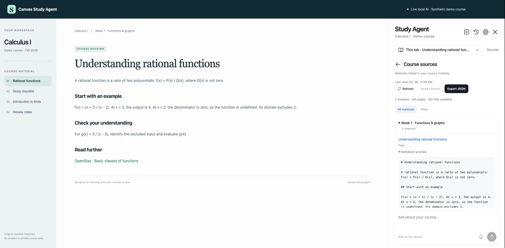
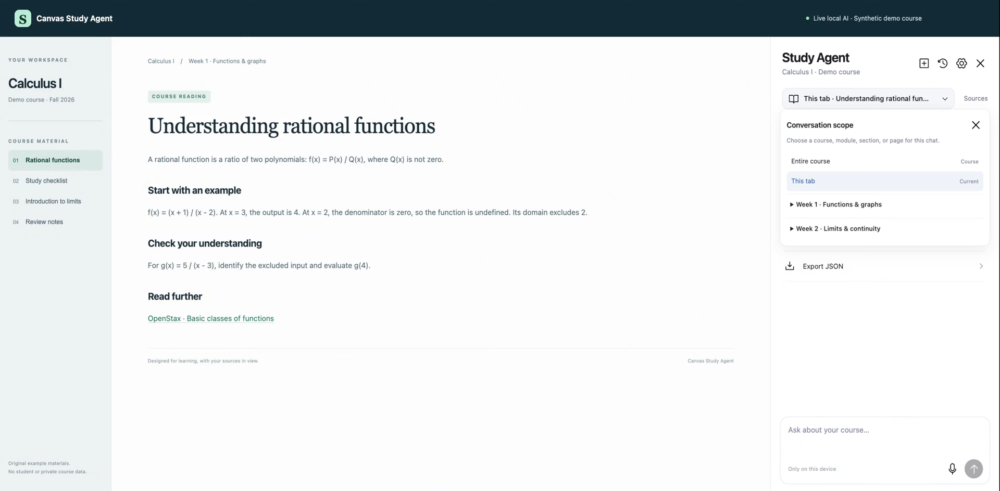

# Canvas Study Agent

### A local AI study companion, right beside your Canvas lesson.

**[Winner — Best Open-Source AI Project](https://mlh.com/events/hacktoberfest-hack-day-menifee-x-msjc-csc-club)**

Hacktoberfest Hack Day Menifee × MSJC CSC Club · October 23, 2026



Canvas spreads a course across lessons, modules, and files. Canvas Study Agent brings the material into a native Chrome sidebar so you can ask a question, follow its sources, and continue an earlier discussion while keeping the lesson open.

[Watch the demo](docs/media/demo.mp4) · [Installation and usage](docs/usage.md) · [Architecture](docs/architecture.md)

## See it work

[](docs/media/demo.mp4)

Recorded in the actual application with **real local Gemma responses** and synthetic course material. Private course content is not published. English voiceover and original music were added for the presentation. [How the demo was made](docs/demo.md).

## Why it helps

| Keep study context local | Stay with the lesson | Return to the evidence |
| --- | --- | --- |
| Gemma 4 E2B runs on your device. Conversations and drafts stay in your browser profile, with no remote chat API. | New chats follow **This tab**. Choose a page, section, module, or entire course when you want a different scope. | Inspect supplied sources, reopen earlier conversations, and use relevant memory from the same course. Source citations and chat memory stay distinct. |

Ask for an explanation, a worked example, or a practice question. Replies stream into the sidebar with rendered math and source links. **Stop** and **Retry** preserve partial answers; **Sources** exposes the cached course material, original file links, and a structured JSON export.

| Chat beside the lesson | Inspect the sources | Choose your context |
| --- | --- | --- |
|  |  |  |

## Build and try

```sh
git clone https://github.com/gabrielromerod/hackathon-canvas-study-agent.git
cd hackathon-canvas-study-agent
npm ci
npm run build
npm test
```

In Chrome, open `chrome://extensions`, enable **Developer mode**, and **Load unpacked** → `extension/`. Open your course and click the extension icon. Use **Settings** for the first model setup; later openings load the completed cache without starting another download.

**Currently supports MSJC Canvas (`msjc.instructure.com`) only.** You'll need access to your own course, Chrome 141+, and a compatible WebGPU device. See the [full guide](docs/usage.md) for installation, updates, controls, permissions, and troubleshooting details.

<details>
<summary>Requirements and practical limits</summary>

- First AI setup explicitly downloads a pinned **2.01 GB** model. The verified OPFS cache is independent of extension version and has survived update/restart testing under the same extension identity. Allow extra disk and runtime memory; a capability check does not guarantee that every GPU can load it.
- Course reading and original file downloads need Canvas access. Cached local inference has been exercised offline; initial model acquisition still needs a network connection.
- Module-linked Canvas Pages are read as Markdown. PDF/DOCX files provide metadata and authenticated links; their bodies are not parsed. Unlinked material and external homework bodies are outside this version.
- Answers can be wrong. Check important course requirements against their original sources; an earlier conversation is not course evidence.
- Local English speech-pack installation failed on the tested Chrome setup. Typing remains available. **12B QAT is disabled**; no compatibility claim is made for it.

More detail: [model, storage, privacy, and native verification](docs/local-ai.md).

</details>

## How it works

The sidebar follows the active course through authenticated readers. One background coordinator owns persistence and generation across windows; a dedicated worker in an offscreen document runs the local model. Course/chat records live in IndexedDB, while verified weights live separately in OPFS.

| Choice | Purpose |
| --- | --- |
| Plain JavaScript, Chrome Side Panel API, esbuild | A native sidebar beside the existing course |
| **LiteRT-LM 0.18.0**, WebGPU `GPU_ARTISAN`, pinned E2B web artifact | On-device generation with bundled JS/WASM |
| Matching tokenizer/Jinja template and scoped retrieval | Count the complete prompt and select bounded course evidence/history |
| IndexedDB + OPFS | Preserve conversations and reuse unchanged model weights across updates |
| Turndown, Marked, DOMPurify, KaTeX | Readable sources, sanitized answers, and local math rendering |

Read the [architecture and turn lifecycle](docs/architecture.md) or the [pinned runtime/model details](docs/local-ai.md). Native tests have demonstrated course citations, same-course chat memory, and cache reuse; the [guide](docs/usage.md) separates those observations from remaining limits.

## License and development

Created by **Gabriel Romero**. Original project code is [MIT licensed](LICENSE). Gemma 4 and its data assets retain [Apache 2.0](https://ai.google.dev/gemma/apache_2); dependencies keep their own licenses. See [third-party notices](public/licenses/NOTICE.txt).

**Codex and GPT-6.1 Sol** assisted with implementation, tests, debugging, and documentation. The installed study assistant uses **Gemma 4 E2B**, with no OpenAI API calls at runtime. [Development disclosure](docs/submission.md#ai-assistance-and-original-work) · [Agent guidance](AGENTS.md).
