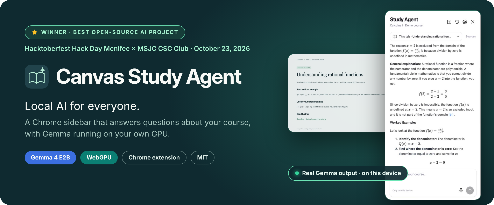
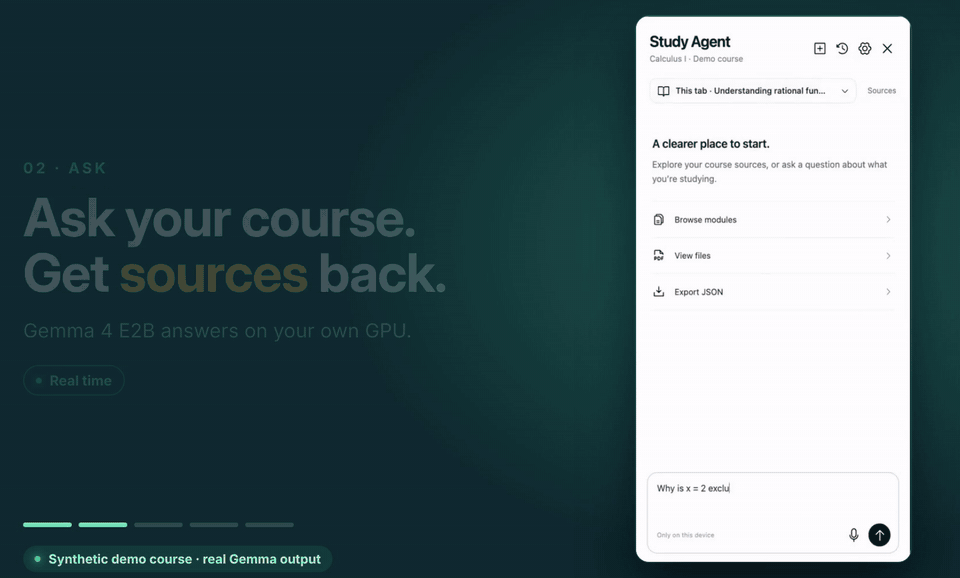
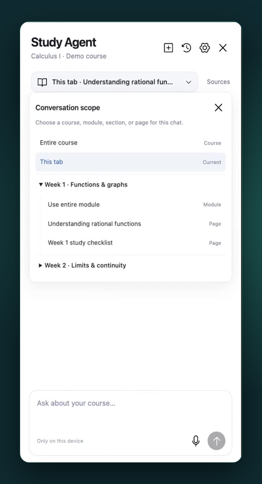
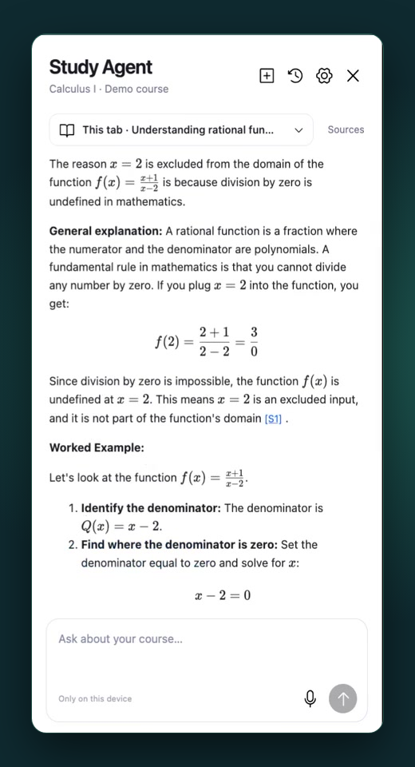
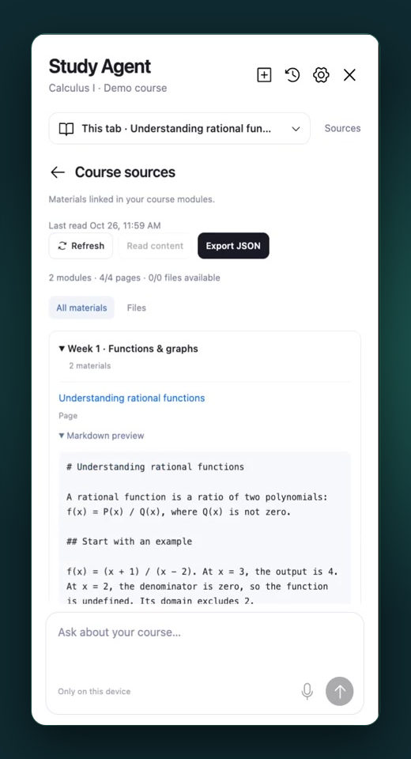
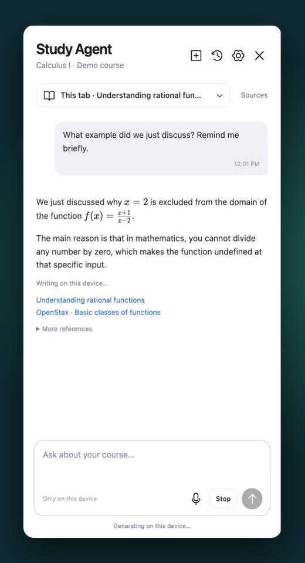
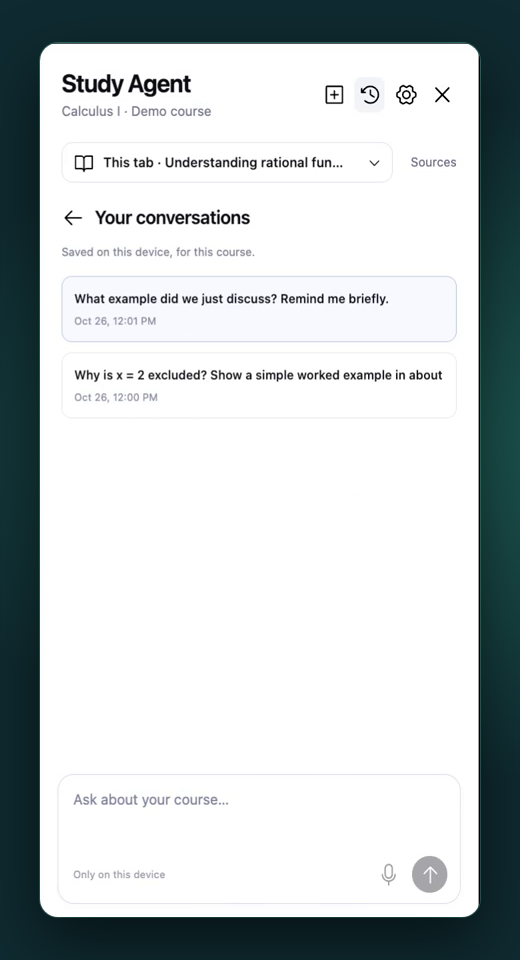
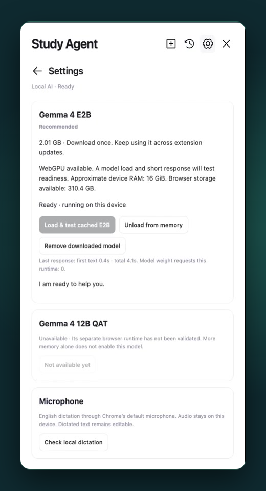
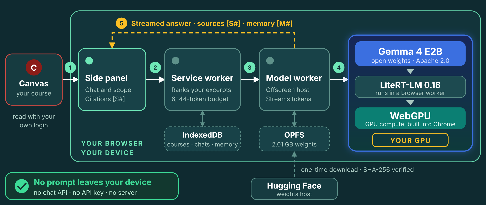

<p align="center">
  
</p>

<p align="center">
  <a href="https://mlh.com/events/hacktoberfest-hack-day-menifee-x-msjc-csc-club"></a>
  
  
  
  
  <a href="LICENSE"></a>
</p>

<p align="center">
  <b>Winner of Best Open-Source AI Project</b> at <a href="https://mlh.com/events/hacktoberfest-hack-day-menifee-x-msjc-csc-club"><b>Hacktoberfest Hack Day Menifee × MSJC CSC Club</b></a> · October 23, 2026
</p>

**Local AI for everyone.** Running a model on your own machine usually means installing LM Studio or Ollama, picking a model, starting a server and wiring up your data. Canvas Study Agent is a Chrome extension instead: it reads your Canvas course and answers questions in a sidebar, with **Gemma 4 E2B running on your own GPU through WebGPU**. No server, no API key, and no prompt ever leaves your device.

<p align="center">
  <a href="docs/media/demo.mp4"></a>
  <br>
  <a href="docs/media/demo.mp4"><b>▶ Watch the 60-second demo</b></a> · <a href="docs/usage.md">Install and use</a> · <a href="docs/architecture.md">Architecture</a>
</p>

<sub>Recorded in the real extension with live Gemma output on a synthetic demo course, so no private course content is published. Sped-up segments are labeled in the video. <a href="docs/demo.md">How the demo was made</a>.</sub>

## Why it matters

| No setup beyond the extension                                                                                                                                                | Private by design                                                                                                                                 | Answers you can check                                                                                                                                   |
| ---------------------------------------------------------------------------------------------------------------------------------------------------------------------------- | ------------------------------------------------------------------------------------------------------------------------------------------------- | ------------------------------------------------------------------------------------------------------------------------------------------------------- |
| WebGPU lets the browser use your GPU directly, so the extension is the whole install. The 2.01 GB model downloads once, is verified by SHA-256 and is cached in the browser. | Inference runs in a local worker. Course pages, chats and drafts stay in your browser profile. There is no chat API, no API key and no telemetry. | Every answer cites the course pages it used (`[S1]`) and earlier chats it drew on (`[M1]`). You can open each source as Markdown, right in the sidebar. |

## Feature tour

<table>
  <tr>
    <td width="33%" valign="top"><br><b>Choose the context.</b> New chats follow the page you're on. You can switch to a module, a section or the whole course.</td>
    <td width="33%" valign="top"><br><b>Ask in plain English.</b> Answers stream in with worked examples, locally rendered math and source links.</td>
    <td width="33%" valign="top"><br><b>Check the evidence.</b> Browse every module-linked page as Markdown, open original files or export the course as JSON.</td>
  </tr>
  <tr>
    <td valign="top"><br><b>It remembers.</b> A new chat can recall relevant earlier conversations from the same course.</td>
    <td valign="top"><br><b>Keep your history.</b> Conversations are saved per course, on your device, and can be reopened anytime.</td>
    <td valign="top"><br><b>Download once.</b> Settings shows the model running on this device, with 0 weight requests after the first setup.</td>
  </tr>
</table>

## How it works

<p align="center"></p>

1. The extension reads module-linked Canvas pages with your existing login and stores them as Markdown.
2. You ask a question in the side panel.
3. The service worker ranks the most relevant excerpts and earlier chats that fit a 6,144-token budget.
4. A model worker runs Gemma 4 E2B through LiteRT-LM on WebGPU, so the computation happens on your GPU.
5. The answer streams back with source (`S#`) and memory (`M#`) citations.

| Choice                                                              | Purpose                                                                 |
| ------------------------------------------------------------------- | ----------------------------------------------------------------------- |
| Plain JavaScript, Chrome Side Panel API, esbuild                    | A native sidebar beside the existing course                             |
| **LiteRT-LM 0.18.0**, WebGPU `GPU_ARTISAN`, pinned E2B web artifact | On-device generation with bundled JS/WASM                               |
| Matching tokenizer/Jinja template and scoped retrieval              | Count the complete prompt and select bounded course evidence/history    |
| IndexedDB + OPFS                                                    | Preserve conversations and reuse unchanged model weights across updates |
| Turndown, Marked, DOMPurify, KaTeX                                  | Readable sources, sanitized answers and local math rendering            |

Read the [architecture and turn lifecycle](docs/architecture.md) or the [pinned runtime and model details](docs/local-ai.md).

## Measured on a real device

| What                              | Result          | How it was measured                                      |
| --------------------------------- | --------------- | -------------------------------------------------------- |
| Model weight requests after setup | **0**           | Cached cold load and warm-up with the model host offline |
| First text from the cached model  | **0.4 s**       | Warm-up reply shown in Settings; total 4.1 s             |
| One-time model download           | **2.01 GB**     | Exact byte count and SHA-256 checked before caching      |
| Test suite                        | **237 passing** | `npm test`                                               |

These are observations from one 16 GiB development machine, not a compatibility guarantee for every GPU.

## Try it

```sh
git clone https://github.com/gabrielromerod/hackathon-canvas-study-agent.git
cd hackathon-canvas-study-agent
npm ci
npm run build
npm test
```

In Chrome, open `chrome://extensions`, enable **Developer mode**, and **Load unpacked** → `extension/`. Open your course and click the extension icon. Use **Settings** for the first model setup; later openings load the completed cache without starting another download.

**Currently supports MSJC Canvas (`msjc.instructure.com`) only.** You'll need access to your own course, Chrome 141+, and a compatible WebGPU device. See the [full guide](docs/usage.md) for installation, updates, controls, permissions and troubleshooting.

<details>
<summary>Requirements and practical limits</summary>

- First AI setup explicitly downloads a pinned **2.01 GB** model. The verified OPFS cache is independent of extension version and has survived update/restart testing under the same extension identity. Allow extra disk and runtime memory; a capability check does not guarantee that every GPU can load it.
- Course reading and original file downloads need Canvas access. Cached local inference has been exercised offline; initial model acquisition still needs a network connection.
- Module-linked Canvas Pages are read as Markdown. PDF/DOCX files provide metadata and authenticated links; their bodies are not parsed. Unlinked material and external homework bodies are outside this version.
- Answers can be wrong. Check important course requirements against their original sources; an earlier conversation is not course evidence.
- Local English speech-pack installation failed on the tested Chrome setup. Typing remains available. **12B QAT is disabled**; no compatibility claim is made for it.

More detail: [model, storage, privacy and native verification](docs/local-ai.md).

</details>

## The hackathon

Canvas Study Agent was built in one day for [Hacktoberfest Hack Day Menifee × MSJC CSC Club](https://mlh.com/events/hacktoberfest-hack-day-menifee-x-msjc-csc-club) on October 23, 2026, where it won **Best Open-Source AI Project**. The five-minute pitch is in [`docs/pitch/`](docs/pitch/Canvas-Study-Agent-Pitch.pptx), and the original submission notes are in [`docs/submission.md`](docs/submission.md).

## License and development

Created by **Gabriel Romero**. Original project code is [MIT licensed](LICENSE). Gemma 4 and its data assets retain [Apache 2.0](https://ai.google.dev/gemma/apache_2); dependencies keep their own licenses. See [third-party notices](public/licenses/NOTICE.txt).

**Codex and GPT-6.1 Sol** assisted with implementation, tests, debugging and documentation. The showcase media (README images, demo film and original score) were produced with AI-assisted tools. The installed study assistant uses **Gemma 4 E2B**, with no cloud inference API calls at runtime. [Development disclosure](docs/submission.md#ai-assistance-and-original-work) · [Agent guidance](AGENTS.md).
