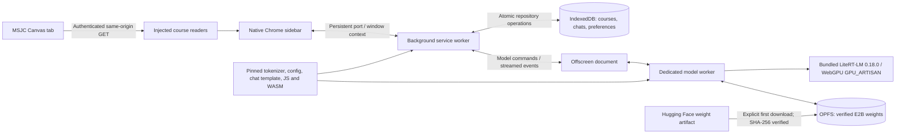
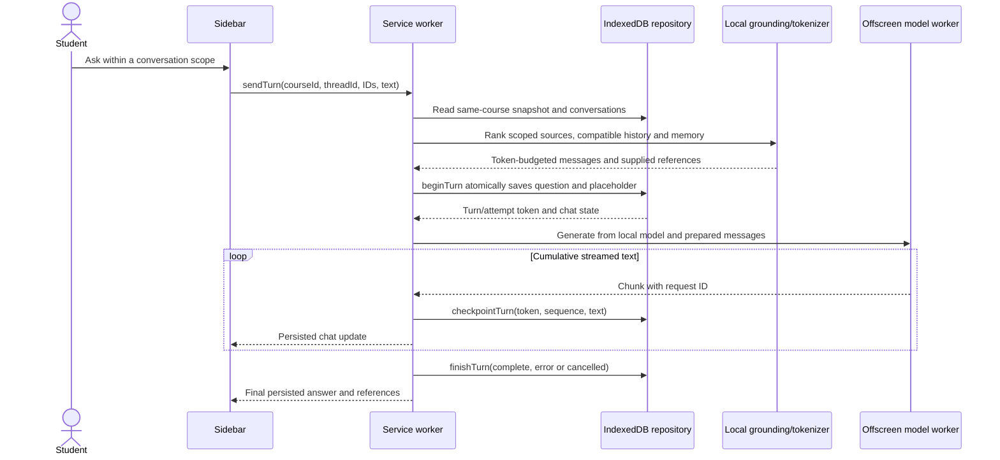

# Architecture

Canvas Study Agent is a Chrome Manifest V3 extension. The sidebar follows one Chrome window's active MSJC Canvas course; a shared service worker coordinates persistence and model ownership across windows. The model runs in a dedicated worker hosted by an offscreen extension document, with its verified weight file kept separately from course/chat data.

New conversations default to “This tab,” resolved against the fresh active Canvas URL and its loaded Page or current module-item metadata. Explicit manual scope choices persist, and existing conversations retain their saved scopes. A Settings gear contains model and language-pack configuration; opening Settings hides the composer. Cached model startup is explicitly cached-only and cannot begin a new download.

The Hugging Face arrow is a weight download, not a prompt API. Cached generation reads extension-owned files. Course refreshes, original attachment downloads, and initial model/language-pack acquisition still require network access.

## A grounded question

Only one profile-wide generation lease runs at a time. Explicit thread IDs prevent a delayed send from entering whichever conversation becomes active later. Persisted turn tokens and increasing sequences independently reject stale checkpoints after cancellation, retry, or another turn. A retry keeps the original question and previous partial answer while creating another assistant attempt. Recovery can mark orphaned streaming answers cancelled after a worker restart, but is called only when no live coordinator owns that course.

## Evidence, memory, and context limits

Loaded Canvas Pages are converted to Markdown locally. Attachments provide metadata and authenticated links; their bodies are not extracted. Assignments, quizzes, discussions, and external tools likewise remain links/metadata in this version.

The grounding module chunks and ranks cached sources inside the selected course/module/section/page scope. It uses the matching bundled tokenizer/template to count the full prompt, including formatting, against a 6,144-token input budget; ordinary generation is capped at 1,024 output tokens. Recent compatible conversation history and selected completed discussions from the same course can contribute context. Source citations (`S#`) and prior-chat memory (`M#`) remain distinct and their actual supplied references are persisted with the answer.

Retrieved content and model Markdown remain untrusted. Rendering sanitizes Markdown and retains only exact link destinations independently supplied by retrieved evidence: validated same-course source URLs and HTTPS links found within that source, such as an actual OpenStax link. Citation links are reconstructed from known references; unsupported model-authored links become plain text. This reduces unsafe rendering and invented evidence links; it does not guarantee that the answer faithfully follows the evidence. A missed Week One requirement was corrected, covered by unit/pinned-tokenizer checks, and retested natively with the original question. The answer returned the correct minimum of three peer posts with `[S8]` linking the independently checked original paragraph. That is a specific regression result rather than a guarantee about every course answer.

## Persistent storage and lifecycle

| Store | Contents | Boundary |
| --- | --- | --- |
| IndexedDB `courses` | Cached snapshot, reader selection, import generation | Course ID |
| IndexedDB `chats` | Threads, drafts, scope, user/assistant attempts, source/memory refs | Course ID, explicit thread and turn tokens |
| IndexedDB `preferences` | Last course for a Chrome window | Window ID, which is session-specific |
| OPFS `canvas-study-agent-models` | Pinned binary and successful completion marker | Model ID, revision, checksum; independent of extension version |

The downloader checks exact byte count and streaming SHA-256 before writing the completion marker. Interrupted/corrupt transfers do not become valid cache entries; byte-range resume is not implemented. Cache lookup checks the saved marker and file size rather than rehashing 2 GB on every open.

The offscreen host shares one worker across panels. Explicit unload releases the resident worker/engine while preserving weights; remove also deletes the pinned binary/marker. A five-minute no-panel idle policy releases resident model resources. The sidebar sends a 20-second heartbeat and permits one reconnect with subscription restoration; it rejects pending writes instead of replaying them.

Native development checks have shown verified E2B loading, streamed replies in two courses, source citations, same-course conversation memory, persistence across an update and a full Chrome restart, and an offline cached cold load/warm-up without HTTP weight requests. These observations apply to the tested device/profile; they do not establish universal GPU compatibility, all retrieval answers, or a validated 12B QAT path.

## Technology and licensing

The browser stack uses plain JavaScript ES modules, esbuild, LiteRT-LM 0.18.0, WebGPU, `idb`, `@huggingface/tokenizers`, `@huggingface/jinja`, `@noble/hashes`, Turndown/GFM, Marked, DOMPurify, and Phosphor icons. Tests use Node's test runner, fake-indexeddb, and jsdom.

Original project code is [MIT licensed](../LICENSE). Gemma 4 and the pinned model-data assets retain Apache 2.0, and runtime libraries retain their own notices. See [third-party NOTICE](../public/licenses/NOTICE.txt) for exact versions, model revisions, hashes, and license provenance. The model's weights are downloaded separately and are not included in the repository or extension ZIP.
